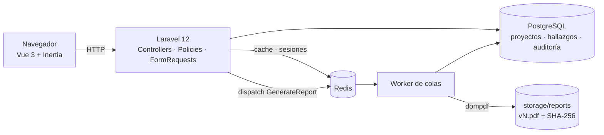

# KRIT0S

> **Del hallazgo al veredicto.** Plataforma de reporting de pentest: proyectos, hallazgos puntuados con CVSS 3.1, biblioteca de plantillas, informes PDF versionados y un portal de solo lectura para el cliente.

**Web del proyecto: [krit0s.vercel.app](https://krit0s.vercel.app)**

*KRIT0S* viene del griego **κριτής**, el que juzga. Un pentest termina en un veredicto, y ese veredicto es el informe.

| | |
|---|---|
| **Stack** | Laravel 12 · Vue 3 + Inertia · TypeScript · PostgreSQL · Redis · Tailwind |
| **Calidad** | 60 tests Pest · Pint · vue-tsc · GitHub Actions sobre PostgreSQL real |
| **Despliegue** | Docker Compose: web + worker de colas + Postgres + Redis |
| **Landing** | [`landing/`](landing): Vite + React, con calculadora CVSS interactiva |

---

## Qué hace

- **Proyectos (engagements).** Cliente, tipo de auditoría, alcance, ventana de pruebas, responsable y equipo. Código secuencial `KRT-AAAA-NNN`.
- **Hallazgos con CVSS 3.1.** La calculadora del formulario muestra la nota en vivo. El servidor la **recalcula siempre** a partir del vector, así que la nota y la severidad no se pueden falsear desde el cliente. Numeración `F-01…` por proyecto.
- **Biblioteca de plantillas.** Diez plantillas iniciales mapeadas a OWASP Top 10, Active Directory y cloud. Un hallazgo se crea desde una plantilla en un clic.
- **Informe PDF versionado.** Se genera en una **cola Redis** (`GenerateReport`), se guarda como versión inmutable `vN` con su huella **SHA-256** y la interfaz consulta su estado hasta que termina. Incluye portada, resumen ejecutivo, distribución por severidad, alcance, tabla resumen y detalle con PoC.
- **RBAC con tres roles**, aplicado con Policies de Laravel en servidor:
  - `admin`: todo, más clientes, usuarios y auditoría.
  - `pentester`: solo los proyectos donde es responsable o miembro del equipo.
  - `client`: solo los proyectos **publicados** de su organización, en lectura, con descarga del PDF.
- **Publicación del veredicto.** Solo el responsable o un admin publica el proyecto en el portal del cliente.
- **Auditoría append-only.** Altas, cambios, publicaciones, generaciones y descargas quedan registradas con usuario e IP.
- **Sin registro público.** Las cuentas las crea un administrador, y nunca se puede degradar al último admin.

## Arquitectura



```
platform/
├─ app/
│  ├─ Support/Cvss/Cvss31.php     # calculadora CVSS 3.1 según la especificación de FIRST (Apéndice A)
│  ├─ Models/                     # Engagement (scope visibleTo), Finding (score derivado), ReportVersion…
│  ├─ Policies/                   # EngagementPolicy, FindingTemplatePolicy
│  ├─ Jobs/GenerateReport.php     # PDF en cola, versión inmutable y hash
│  └─ Http/Controllers/           # + Admin/ (clientes, usuarios, auditoría)
├─ resources/js/
│  ├─ lib/cvss.ts                 # espejo TS de la calculadora para la vista previa
│  ├─ components/krit0s/          # CvssCalculator, SeverityBadge, SeverityBar…
│  └─ pages/                      # Dashboard, engagements/, findings/, templates/, admin/
├─ resources/views/reports/       # plantilla del informe PDF
└─ tests/                         # Pest: CVSS, acceso por rol, hallazgos, informes, admin
landing/                          # web de producto (Vite + React + framer-motion)
```

**Decisiones**

- **La severidad nunca viene del cliente.** El evento `saving` de `Finding` normaliza el vector y deriva la nota y la severidad. El formulario solo hace una vista previa.
- **La autorización vive en el servidor.** `Engagement::scopeVisibleTo()` filtra cada listado y las Policies protegen cada acción. Las rutas anidadas usan `scopeBindings()`, así que un hallazgo de otro proyecto devuelve 404 aunque se adivine su ID.
- **Los informes son inmutables.** Regenerar crea `v2`, nunca sobrescribe `v1`, y el SHA-256 permite demostrar qué versión se entregó.
- **El trabajo pesado va fuera del request.** dompdf corre en el worker. La caché del panel vive en Redis con un TTL de 60 s por usuario.

## Ejecutar

### Docker (stack completo)

```bash
cp platform/.env.example platform/.env
docker compose run --rm web php artisan key:generate --show   # pega la clave en APP_KEY
docker compose up --build
```

Abre http://localhost:8080. Con `APP_DEMO=true`, la base de datos se siembra con datos ficticios y el login muestra las cuentas demo.

### Local (sin Docker)

Requisitos: PHP 8.2+ (`pdo_sqlite`, `intl`, `gd`, `zip`), Composer y Node 20+.

```bash
cd platform
composer install && npm install
cp .env.example .env && php artisan key:generate
php artisan migrate --seed
composer dev        # servidor + worker de colas + logs + Vite
```

### Cuentas demo (datos ficticios)

| Rol | Email | Contraseña |
|---|---|---|
| Admin | `admin@krit0s.test` | `krit0s-demo` |
| Pentester | `ana@krit0s.test` | `krit0s-demo` |
| Cliente (Banca Aurora) | `cliente@aurora.test` | `krit0s-demo` |

Todas las empresas, personas y vulnerabilidades del seeder son inventadas.

## Tests

```bash
cd platform
vendor/bin/pest           # 60 tests: CVSS contra vectores de referencia, aislamiento por rol, PDF, auditoría
vendor/bin/pint --test
npx vue-tsc --noEmit

cd ../landing && npm test
```

En local los tests corren sobre SQLite en memoria. En CI corren sobre **PostgreSQL 17 y Redis 7** reales.

## Hoja de ruta

- [ ] Retest: enlazar un hallazgo con su verificación en un proyecto posterior
- [ ] Importar resultados de Burp, Nessus y Nuclei
- [ ] Marca blanca por organización en el PDF
- [ ] MFA (TOTP) para cuentas de cliente
- [ ] Multi-tenant SaaS

---

Diseñado y construido por **Samuel "Flako" Fuentes** · [portfolio](https://flako-dev.vercel.app)
